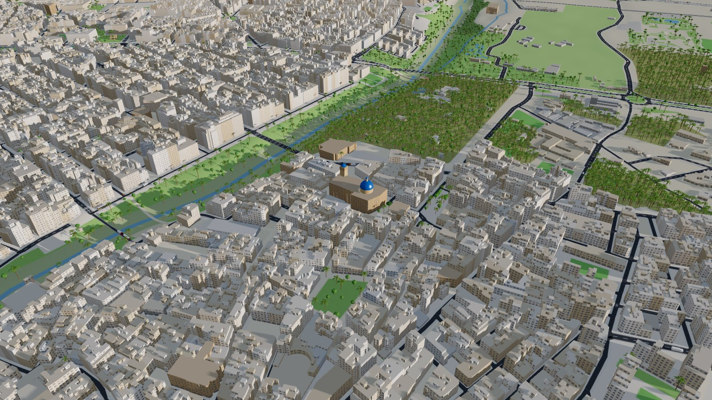

# Elx · Trànsit 3D — simulador de tráfico de Elche

Simulador microscópico del tráfico de **Elche (Elx)** con visualización 3D en el navegador.
Cada vehículo se mueve por la red viaria real de la ciudad (OpenStreetMap), sobre el relieve
del MDT05 del IGN, entre los 62.000 edificios del Catastro, el Palmeral y las rondas, con semáforos, glorietas,
prioridades, autobuses urbanos y una demanda que cambia a lo largo del día.

**Pruébalo en línea:** <https://elche-traffic.gp-web.workers.dev>



## Índice

- [Puesta en marcha](#puesta-en-marcha)
- [Qué incluye](#qué-incluye)
- [Controles](#controles)
- [Calibración y fuentes](#calibración-y-fuentes)
- [Datos: descarga y procesado](#datos-descarga-y-procesado)
- [Arquitectura](#arquitectura)
- [Despliegue](#despliegue)
- [Limitaciones](#limitaciones)
- [Licencias de los datos](#licencias-de-los-datos)

## Puesta en marcha

Requisitos: **Node.js 22.12 o superior** (lo piden Vite 8 y Wrangler) y un navegador con
WebGL 2 y Web Workers de módulo (Chrome, Edge, Firefox o Safari recientes).

```bash
git clone https://github.com/IsaiaPhiliph/elche-traffic.git
cd elche-traffic
npm install
npm run dev        # http://localhost:5180
```

Los datos procesados ya están en `public/data/`, así que no hace falta descargar nada para
arrancar. Para regenerarlos desde las fuentes originales, ver
[Datos: descarga y procesado](#datos-descarga-y-procesado).

| Script | Qué hace |
| --- | --- |
| `npm run dev` | Servidor de desarrollo de Vite en el puerto 5180, con recarga en caliente |
| `npm run build` | Comprobación de tipos (`tsc --noEmit`) y compilación de producción en `dist/` |
| `npm run preview` | Sirve `dist/` en local para probar la compilación |
| `npm run typecheck` | Solo la comprobación de tipos |
| `npm run data` | Descarga todas las fuentes y regenera `public/data/` (los cuatro pasos siguientes) |
| `npm run data:fetch` | Descarga de OpenStreetMap por Overpass → `data/raw/*.json` |
| `npm run data:catastro` | Edificios INSPIRE del Catastro → `data/raw/catastro/` |
| `npm run data:dem` | MDT05 del IGN por WCS → `data/raw/dem/` |
| `npm run data:build` | Procesa `data/raw/` y escribe `public/data/` |
| `npm run deploy` | Compila y publica en Cloudflare Workers |

## Qué incluye

**Ciudad en 3D**

- Red viaria de OSM recortada al casco urbano dentro de las rondas (≈7,3 × 6 km): 490 km de
  ejes, carriles por sentido, límites de velocidad, sentidos únicos, puentes con rampas y
  túneles.
- **Relieve** del Modelo Digital del Terreno MDT05 del IGN (LiDAR del PNOA, malla de 5 m),
  con 2 km de margen: el cauce del Vinalopó y sus barrancos, la subida hacia el norte y las
  sierras del horizonte. El MDT del servicio WCS viene redondeado al metro, así que se suaviza
  (≈15 m) antes de usarlo, y bajo las calles el terreno se iguala a la rasante.
- **Rasante de las calles:** cada calle sigue el terreno (con puntos intermedios donde cambia
  la pendiente). Los puentes van en línea recta entre sus estribos, de modo que el viaducto de
  la A-7 queda a 30 m sobre el Vinalopó y las pilas bajan hasta el fondo del cauce.
- **Pasos inferiores:** los tramos con capa negativa de OSM (Ronda Sud, President Adolfo
  Suárez, Camí dels Arcs, Camí de l'Omet…) bajan 5,5 m por capa con rampas del 6 % a lo largo
  de la misma vía. En la parte descubierta el suelo se recorta en trinchera con muros de
  contención y pretil; en la cubierta hay hastiales, techo y bocas, y el terreno de encima
  queda intacto. Los túneles sin capa (soportales, pasajes cubiertos) se dejan a nivel de calle.
- 62.291 volúmenes de edificio del **Catastro** (INSPIRE), con su número real de plantas y uso
  (residencial, industrial, oficinas, comercio, servicios públicos). Los monumentos de OSM
  sustituyen a sus parcelas; la Basílica de Santa María lleva cúpula y campanario.
- Usos del suelo, cauce del Vinalopó, parques, plazas peatonales y vías del tren pintados en
  una textura sobre el terreno.
- ≈53.000 palmeras y árboles: los ejemplares de OSM y los generados dentro de los huertos del
  Palmeral, parques y zonas verdes.
- Marcas viales en el sombreador (carriles, ejes, pasos de peatones, líneas de detención y
  ceda el paso), aceras con bordillo, isletas de glorieta y alumbrado público nocturno.
- Sol real de Elche (latitud, declinación y horario de verano) según la hora y la época del
  año, cielo, niebla, sombras, ventanas que se iluminan de noche y faros de los vehículos.

**Simulación**

- **Seguimiento de vehículos:** Intelligent Driver Model (IDM) con parámetros por tipo
  (turismo, furgoneta, camión, autobús, moto) y variación por conductor.
- **Cambio de carril:** MOBIL simplificado, con cambios obligatorios para colocarse antes de
  girar, aparcar o llegar a una parada de autobús.
- **Intersecciones:** maniobras entre tramos con conflictos precalculados (trayectorias que se
  cortan o confluyen), reserva del cruce, «no bloquear el cruce», prioridad del anillo en
  glorietas, STOP y ceda el paso de OSM, prioridad por jerarquía viaria y prioridad a la
  derecha entre calles iguales, incorporación en cremallera y desbloqueo por impaciencia.
- **Semáforos:** 78 reguladores reconstruidos a partir de los 231 semáforos de OSM, con dos
  fases por eje y reparto de verde según carriles y jerarquía. Modos: tiempo fijo, onda verde
  este–oeste, accionados por demanda (detectores) y apagados (ámbar intermitente).
- **Rutas:** A* sobre el grafo de tramos con prohibiciones de giro de OSM, tiempos de viaje
  observados y reencaminamiento dinámico de los vehículos detenidos.
- **Autobuses urbanos:** 25 recorridos de las líneas reales de OSM (A, B, C, D, E, F, G, H, I,
  J, K2, L, M, N1–N3, NT, CN, R1–R4) con sus paradas y tiempos de parada.
- **Demanda:** viajes internos, de entrada, de salida y de paso, con perfil horario de día
  laborable (puntas a las 8, 13–14 y 19 h). Orígenes y destinos ponderados por la superficie
  construida de cada calle según su uso, más polos (hospitales, universidad, centros
  comerciales, estaciones).
- **Indicadores:** vehículos en red, velocidad media, viajes/h, tiempo y demora media,
  porcentaje de detenidos, CO₂ estimado con un modelo de potencia en rueda (incluida la
  pendiente de cada tramo), y mapa de congestión por tramo.

## Controles

| Acción | Cómo |
| --- | --- |
| Mover / girar / acercar | arrastrar · botón derecho · rueda |
| Pausar / reanudar | `Espacio` o ⏸ |
| Velocidad de simulación | `1`–`6` o los botones ×1 … ×60 |
| Mapa de congestión | `H` o capa «Congestión» |
| Seleccionar vehículo, semáforo o calle | clic (ficha con datos y ruta resaltada) |
| Seguir al vehículo / vista conductor | botones de la ficha · `F` |
| Cortar o reabrir una calle | herramienta «Cortar / abrir calles» o botón de la ficha |
| Deseleccionar | `Esc` |

**Escenarios:** punta de mañana, mediodía, punta de tarde y noche; partido en el Martínez
Valero (llegadas desde las 19:00 y salida a las 22:50); Zona de Bajas Emisiones del centro
histórico (fase 1 de la ordenanza: entre el Vinalopó y Filet de Fora, de Mestre Albéniz a
l'Àngel), y corte del Pont de Canalejas o del Pont d'Altamira.

## Calibración y fuentes

| Dato | Valor usado | Fuente |
| --- | --- | --- |
| Población | 245.575 (municipio), 198.295 (núcleo) | OSM / INE 2025 |
| Reparto modal interno | coche 49 %, a pie 40 %, transporte público 9 % | [PMUS de Elche](https://alicanteplaza.es/que-dice-el-pmus-de-elche-no-se-utiliza-mas-el-transporte-publico-por-falta-de-servicio-y-comodidad) |
| Duración media de viaje | 20,7 min (todos los modos) | PMUS de Elche |
| Parque móvil (2018) | 160.583 vehículos (70 % turismos, 12,5 % furgonetas y camiones, 15 % motos) | [PMUS de Elche](https://alicanteplaza.es/que-dice-el-pmus-de-elche-no-se-utiliza-mas-el-transporte-publico-por-falta-de-servicio-y-comodidad) |
| CV-865 Elche–Santa Pola | 17.221 veh/día | [Generalitat vía AlicantePlaza](https://alicanteplaza.es/el-desdoble-de-la-carretera-entre-elche-y-santa-pola-sera-una-via-parque-y-se-invertiran-12-millones) |
| A-7/A-70 Elche–Crevillent | ≈65.000 veh/día | [Ministerio de Transportes vía El Periòdic](https://www.elperiodic.com/elx/tramo-urbano-ronda-pasa-titularidad-municipal-ministerio-confirma-pronto-mejorara-entre-elche-crevillente_815100) |
| Líneas de autobús más usadas | B, D, K1, K2, M (más frecuencia) | [Avanza Elx, 2026](https://alicanteplaza.es/alicanteplaza/elcheplaza/el-servicio-de-autobus-en-elche-crece-en-2026-con-54-millones-de-viajeros) |
| Perímetro de la ZBE | fase 1 de la ordenanza | [AlicantePlaza](https://alicanteplaza.es/zbe-elche-perimetro-centro) |
| Límites por defecto | 50 / 30 / 20 km/h según carriles | RD 970/2020 |
| Hora punta | 7,5–10 % de la IMD | estudios de tráfico de la Generalitat |

Con esto, la demanda base es de unos 88.000 viajes diarios internos en coche (núcleo urbano,
40 % de los desplazamientos internos) más ≈120.000 de entrada y ≈157.000 de salida por los
accesos, de los que una parte es tráfico de paso por la A-7 y la EL-20. Las intensidades de los
accesos sin aforo publicado (N-340, CV-84, CV-855…) son estimaciones según la jerarquía viaria;
están en `scripts/config.mjs`.

## Datos: descarga y procesado

Las descargas se guardan en `data/raw/` (≈575 MB, fuera del repositorio por `.gitignore`), y
el procesado genera los ficheros de `public/data/` (≈12 MB, sí versionados para que el
simulador funcione nada más clonarlo).

```bash
npm run data       # o, por pasos:
npm run data:fetch      # OSM: calles, prohibiciones de giro, edificios, usos, árboles, PDI, bus, tren (≈11 MB)
npm run data:catastro   # Catastro: ZIP INSPIRE de edificios del municipio 03065 (26 MB; ≈520 MB descomprimido)
npm run data:dem        # IGN: 12 teselas ASCII Grid del MDT05 (≈41 MB)
npm run data:build      # procesado → public/data/
```

- Las descargas se pueden repetir sin coste: se salta lo que ya está en `data/raw/`
  (`node scripts/fetch-osm.mjs data/raw --force` vuelve a pedir OSM). `data:fetch` alterna
  entre varios servidores Overpass si uno está saturado y `data:dem` reintenta las teselas que
  fallan.
- El área de estudio, el origen de coordenadas, el polígono de la ZBE, las intensidades de los
  accesos y las frecuencias de autobús están en [`scripts/config.mjs`](scripts/config.mjs).
- Si falta el Catastro se usan las alturas de los edificios de OSM; si falta el MDT, la ciudad
  sale plana. El resto de fuentes es obligatorio.

**Sistema de coordenadas.** Todo se proyecta a metros locales con origen en el centro del área
(x hacia el este, z hacia el sur, y hacia arriba). La cota y = 0 es el terreno en el origen,
85 m sobre el nivel del mar.

**Ficheros generados en `public/data/`:**

| Fichero | Tamaño | Contenido |
| --- | --- | --- |
| `network.json` | 1,7 MB | Grafo de simulación: nodos, tramos con carriles y límites, geometría, maniobras con sus conflictos, reguladores semafóricos, ZBE y líneas de autobús |
| `roads.json` | 1,4 MB | Geometría de render: ejes recortados en los cruces con su perfil 3D, cruces, isletas, zonas peatonales, vías del tren y nombres |
| `buildings.json` | 5,9 MB | Huellas, alturas, plantas y uso de cada edificio (Catastro + monumentos de OSM) |
| `areas.json` | 0,3 MB | Polígonos de usos del suelo y cauces |
| `trees.json` | 0,9 MB | Posición, tipo y tamaño de palmeras y árboles |
| `pois.json` | 17 kB | Lugares de interés con su importancia para las etiquetas |
| `terrain.bin` + `terrain.json` | 2,3 MB | Rejilla de alturas de 10 m (1137 × 1005, Int16 en centímetros respecto al datum) y sus metadatos |

## Arquitectura

```
scripts/                     preprocesado (Node)
  fetch-osm.mjs              descarga por Overpass (calles, edificios, usos, árboles, PDI, bus, tren)
  fetch-catastro.mjs         edificios INSPIRE del Catastro (municipio 03065)
  fetch-dem.mjs              MDT05 del IGN por WCS (teselas ASCII Grid)
  build-data.mjs             genera public/data/
  config.mjs                 área, origen, ZBE, aforos de los accesos, frecuencias de bus
  lib/network.mjs            grafo: tramos, carriles, maniobras, conflictos, semáforos, rotondas
  lib/catastro.mjs           lector GML en streaming y conversión UTM 30N → local
  lib/buildings.mjs          alturas, usos y monumentos
  lib/areas.mjs              usos del suelo y generación del Palmeral
  lib/terrain.mjs            lectura y suavizado del MDT, rejilla de alturas ajustada a las calles
  lib/geo.mjs polygons.mjs   proyección, rejilla espacial y utilidades de polígonos
src/main.ts                  arranque, interfaz, selección, cámara y bucle de render
src/sim/                     simulación (Web Worker)
  simulation.ts              IDM, MOBIL, cruces, altas/bajas, autobuses, indicadores
  network.ts router.ts signals.ts demand.ts
  worker.ts protocol.ts      bucle de simulación e intercambio de instantáneas
src/render/                  Three.js
  scene.ts                   cámara, controles, sol, cielo, niebla, sombras
  roads.ts                   calzadas, marcas viales, congestión, cortes, rutas
  terrain.ts ground.ts        alturas, selección sobre el relieve y malla del terreno
  buildings.ts vegetation.ts vehicles.ts signals.ts labels.ts landmarks.ts
src/ui/                      estilos y gráfica
index.html                   interfaz (paneles, barra superior, accesos rápidos)
wrangler.jsonc               despliegue en Cloudflare Workers
```

La simulación corre en un Web Worker con paso de 0,2 s y envía instantáneas que el hilo
principal interpola en cada fotograma; con unos 3.000–5.000 vehículos va a ×60 sin perder
fotogramas en un portátil reciente.

## Despliegue

La aplicación es un sitio estático: tras `npm run build`, la carpeta `dist/` (≈15 MB, 12
ficheros) se puede servir desde cualquier alojamiento estático. Usa rutas relativas
(`base: './'`), así que también funciona en un subdirectorio.

La versión en línea está en Cloudflare Workers con *static assets*
([`wrangler.jsonc`](wrangler.jsonc)):

```bash
npx wrangler login   # una vez
npm run deploy
```

En el plan gratuito de Cloudflare, servir ficheros estáticos no tiene límite de peticiones
ni de transferencia. El fichero más grande (`buildings.json`, 5,9 MB) está muy por debajo del
máximo de 25 MiB por fichero. Para publicarlo con otra cuenta, cambia `name` en
`wrangler.jsonc`.

## Limitaciones

- No se simulan peatones ni bicicletas; los semáforos de paso de peatones sí detienen el
  tráfico.
- La demanda es sintética (no hay una matriz origen–destino pública); está calibrada en
  volumen y reparto horario, no en cada calle.
- Los planes semafóricos se reconstruyen a partir de la posición de los semáforos, no de los
  planes reales del Ayuntamiento.
- El relieve tiene una resolución de 10 m en la escena y está suavizado: los taludes del
  Vinalopó son algo más tendidos que en la realidad. Los túneles ocultan los vehículos.
- La profundidad de los pasos inferiores sale de la capa de OSM (5,5 m por nivel), no de
  proyectos reales.

## Licencias de los datos

- Red viaria, usos del suelo, árboles, PDI y líneas de autobús: © colaboradores de
  OpenStreetMap, [ODbL](https://www.openstreetmap.org/copyright).
- Edificios: © Dirección General del Catastro, servicio INSPIRE de edificios.
- Relieve: MDT05 © Instituto Geográfico Nacional, [CC BY 4.0](https://www.ign.es/resources/licencia/Condiciones_licenciaUso_IGN.pdf).

Los ficheros de `public/data/` son obras derivadas de estas fuentes y mantienen sus
licencias; la interfaz muestra las atribuciones. Si reutilizas los datos de OSM, la ODbL
exige citar la fuente y compartir las bases de datos derivadas con la misma licencia.
